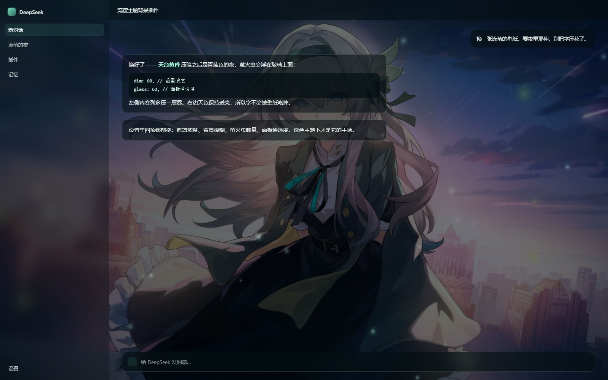
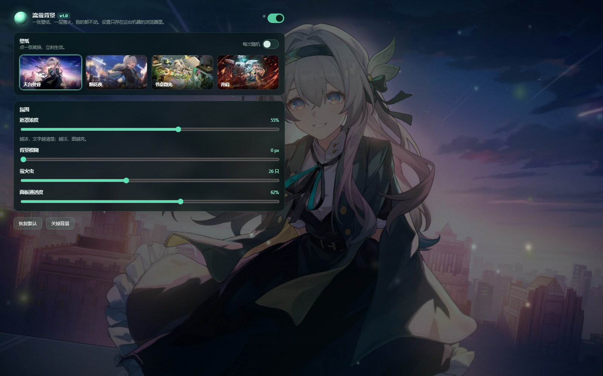
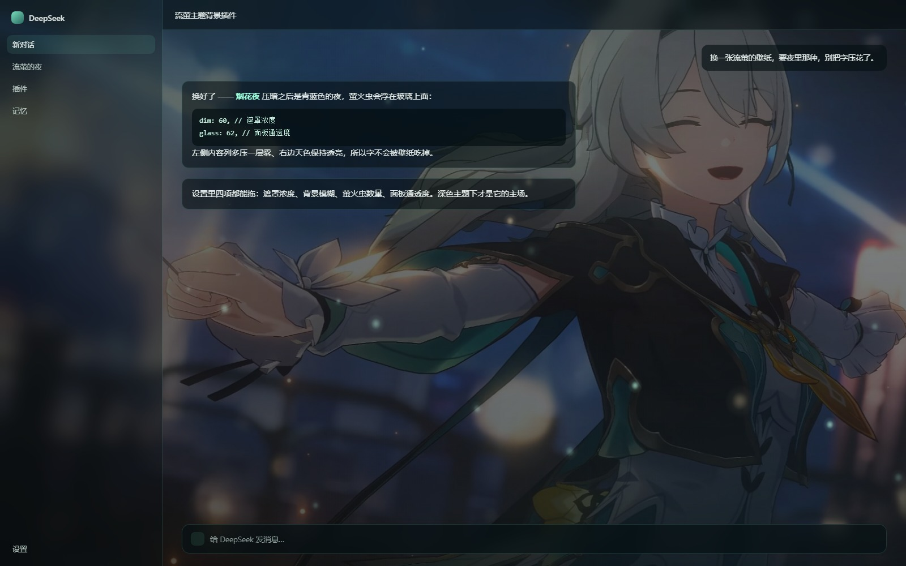

# dsh-firefly-bg · 流萤背景

Firefly-themed wallpaper background for the [DeepSeek Harness](https://github.com/deepseek-ai) Web GUI:
four hand-picked wallpapers behind your chat, a canvas firefly field on top of them, and sliders for
veil, blur, particle count and panel transparency.

给 DSH 的 Web 界面挂一张**流萤**壁纸，再撒一层萤火虫。面板自动变成半透明玻璃，文字仍然清楚。



---

## Features

- **纯 DOM 背景层** — `position: fixed; z-index: -2`，不注册任何槽位浮层，换布局也不会被挤掉。
- **面板变玻璃** — 改主题令牌（`--dsw-alias-bg-base / -bg-layer-1..3 / -bg-overlay`），
  关掉开关会把改过的变量原样删掉，界面立刻回到出厂外观。
- **打洞（punch-through）** — 光把令牌改透明还不够，外壳里还有写死的不透明底色
  （当前版本是 `div.mP3x-q_frame`，`rgb(249,250,251)`、整屏 1280×822）。所以会从 `body`
  往下走，把「跨半屏以上、底色不透明、没有 `backdrop-filter`」的容器改成
  `background-color: transparent !important`（记下原值，关掉时还原）。类名是构建期哈希，
  所以**不写死类名**，只认颜色和尺寸；外壳晚渲染 / 切页新长出来的容器靠 4 次延时补打 +
  `MutationObserver`（节流 800ms）补齐。
- **深色 / 浅色两套参数** — 深色是「压暗 + 夜色雾」，浅色是「白雾 + 自动 2.5px 模糊」，
  否则浅色主题下白面板压在亮图上会糊成一片。
- **萤火虫** — canvas 画的（预渲染精灵 + `lighter` 混合），默认 26 只；`prefers-reduced-motion`
  下自动变成静止的一帧，标签页切走就停。
- **零依赖、零网络** — 图片全在包内，不写用户目录、不发请求，设置只存在 `localStorage`。

## Install

```bash
dsh plugin --profile web add github:levitate403/dsh-firefly-bg
```

装完**刷新一次页面**（`Ctrl+R`）。bundle 层要重启 dsh 才会重新组装；如果设置里看不到
「流萤背景」，把 dsh 退出重开一次。

本地开发时可以直接链目录：

```bash
git clone https://github.com/levitate403/dsh-firefly-bg.git
dsh plugin --profile web add link:/absolute/path/to/dsh-firefly-bg
```

## Usage

**设置 → 流萤背景**：

| 项 | 作用 |
|---|---|
| 启用背景 | 总开关，关掉等于没装 |
| 壁纸 | 四张：天台黄昏 / 烟花夜 / 书桌微光 / 并肩。点一下就换 |
| 每次随机 | 每次打开页面随机挑一张（只在这台机器的浏览器里记） |
| 遮罩浓度 | 越浓文字越清楚，越淡图越亮 |
| 背景模糊 | 糊掉细节，只留颜色和光 |
| 萤火虫 | 0–64 只，0 = 只留静态背景 |
| 面板通透度 | 往左更透（更透出壁纸），往右更实（更好读） |
| 缓慢漂移 | 壁纸极慢推近、平移，像镜头在呼吸 |

设置全存 `localStorage`（key `dsh-firefly-bg/settings/v1`），不上传、不写宿主配置。

> 想要「流萤」那种夜色感，把 **设置 → 外观 → 深色主题** 打开再看：深色的青黑玻璃 + 会呼吸的
> 萤火才是这套壁纸的主场。浅色主题也能用（自动加白雾和一点模糊），但会是淡雅插画风。

## Screenshots

| | |
|---|---|
|  |  |
| 设置页（深色主题，天台黄昏壁纸） | 聊天页（深色主题，烟花夜壁纸） |

## Routes (host half)

```
GET /api/firefly-bg/list        → { ok, wallpapers:[{ id, name, note, position }] }
GET /api/firefly-bg/img/<id>    → full-size wallpaper (jpeg)
GET /api/firefly-bg/thumb/<id>  → 560px thumbnail for the settings grid
GET /api/firefly-bg/ping?b=<N>  → the browser half reports which build it mounted
GET /api/firefly-bg/health      → liveness + lastPing
```

`/health` 里的 `lastPing` 用来确认「页面到底有没有吃到新代码」：刷新页面后
`lastPing.build` 应该等于 `client.js` 里的 `BUILD`，对不上就是浏览器缓存了旧模块。

## Compat

如果同时装了 `dsh-plugin-wallpaper-engine` 之类也改 `--dsw-alias-bg-*` 的插件，两边会互相覆盖
（后挂的赢）。要用这个就把那个关掉。

## Develop

```
package.json        # dsh.bundle → cordis.patch.yml, dsh.client → client.js
cordis.patch.yml    # 往 profile 里 insert 一条 bundle
index.js            # 宿主半端：webServer 路由，把 assets/ 里的图发出去
client.js           # 浏览器半端：背景层 + 令牌覆盖 + 打洞 + 设置面板
assets/wallpapers/  # 2560 宽的原图
assets/thumbs/      # 560 宽缩略图
```

- 只改 `client.js`：刷新页面就生效（DSH 的客户端插件有 HMR）。
- 改了 `index.js`（宿主半端）：要让 dsh 退出重开，热更新只认安装那一刻的代码。
- 加壁纸：把图放进 `assets/wallpapers/<id>.jpg` 和 `assets/thumbs/<id>.jpg`，再往 `index.js`
  的 `WALLPAPERS` 里加一条（`id / name / note / position`），重启即可。
- `client.js` 顶上的 `BUILD` 每改一次 +1，面板右上角显示 `v1.0 · b<N>` —— 看不到新数字就说明
  浏览器还在用缓存的旧 bundle，硬刷新（`Ctrl+Shift+R`）。

## Credits & license

- 插件源码：[MIT](LICENSE)。
- `assets/wallpapers/`、`assets/thumbs/` 下四张壁纸来自 miyoushe（米游社）公开投稿，版权属于
  **原作者 / miHoYo**，仅作个人桌面背景用，MIT 不覆盖这些图片，请勿单独再分发或商用。
- 《崩坏：星穹铁道》流萤（Firefly）及角色形象版权归 miHoYo / HoYoverse 所有。本项目为非官方粉丝作品。
